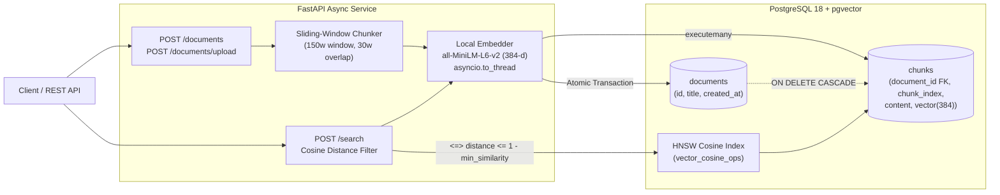

# RecallEngine


An asynchronous semantic knowledge retrieval backend built with **FastAPI**, **PostgreSQL 18 (`pgvector`)**, and local CPU-bound **Sentence-Transformers** (`all-MiniLM-L6-v2`).

RecallEngine ingests raw text and Markdown/plain-text documents, splits them using an overlapping sliding-window chunker to prevent embedding truncation, persists normalized parent-child records in PostgreSQL, and serves low-latency cosine-similarity search with SQL-level noise thresholding.

---

## Architecture



---

## Key Engineering Decisions

* **Sliding-Window Text Chunking (`150` words, `30`-word overlap):** `all-MiniLM-L6-v2` silently truncates inputs beyond 256 tokens (~180–200 words). Splitting documents into overlapping 150-word windows ensures full-document recall while preserving sentence context across chunk boundaries.
* **Normalized Parent-Child Schema (`documents` → `chunks`):** Separates document metadata from vector chunks with a `UNIQUE (document_id, chunk_index)` constraint and `ON DELETE CASCADE` referential integrity, wrapped in atomic `asyncpg` transactions.
* **Non-Blocking CPU Inference (`asyncio.to_thread`):** Offloads CPU-bound PyTorch tokenization and batch matrix encoding to background worker threads so FastAPI's async event loop never stalls during concurrent requests.
* **HNSW Vector Indexing & Similarity Thresholding:** Queries use `pgvector`'s `<=>` cosine distance operator backed by an HNSW index and filter low-relevance noise directly in SQL (`(embedding <=> $1) <= 1 - min_similarity`).

---

## Project Structure

```text
RecallEngine/
├── compose.yml                  # PostgreSQL 18 + pgvector container definition
├── pyproject.toml               # uv dependency & pytest configuration
├── src/
│   └── recallengine/
│       ├── main.py              # FastAPI lifecycle, validation & REST endpoints
│       ├── db.py                # asyncpg connection pool, pgvector registration & DDL
│       ├── chunker.py           # Overlapping sliding-window text splitter
│       └── embedder.py          # Thread-safe local SentenceTransformer inference
└── tests/
    ├── test_chunker.py          # Pure unit tests for chunking boundaries & overlap
    └── test_api.py              # Async integration tests for upload, search & cascade delete
```

---

## Tech Stack

* **Backend:** Python 3.12+, FastAPI, Uvicorn, Pydantic v2
* **Database:** PostgreSQL 18, `pgvector` (v0.8+), `asyncpg` connection pooling
* **ML / Embeddings:** `sentence-transformers` (`all-MiniLM-L6-v2`, 384 dimensions, CPU PyTorch)
* **Tooling & Testing:** `uv`, Podman / Podman Compose, `pytest`, `pytest-asyncio`, `httpx`

---

## Quickstart

### 1. Start PostgreSQL with `pgvector`
```bash
podman-compose up -d
```

### 2. Install Dependencies & Start the Server
```bash
uv sync
uv run fastapi dev src/recallengine/main.py
```
Interactive Swagger documentation is available at **`http://127.0.0.1:8000/docs`**.

### 3. Run Unit & Integration Tests
```bash
uv run pytest -v
```

---

## API Reference

| Method | Endpoint | Description |
| :--- | :--- | :--- |
| `POST` | `/documents` | Ingest a JSON document (`title`, `content`), chunk, and store embeddings atomically. |
| `POST` | `/documents/upload` | Upload a UTF-8 `.md` or `.txt` file (`multipart/form-data`, max 500 KB). |
| `GET` | `/documents` | Paginated document listing (`limit`, `offset`) with total count and chunk counts. |
| `DELETE` | `/documents/{id}` | Delete a document and cascade-delete all associated vector chunks. |
| `POST` | `/search` | Semantic vector search with `top_k` limit and `min_similarity` threshold filtering. |

### Example Usage

**Upload a Markdown document:**
```bash
curl -X POST http://127.0.0.1:8000/documents/upload \
  -F "file=@architecture.md"
```

**Query by semantic meaning:**
```bash
curl -X POST http://127.0.0.1:8000/search \
  -H "Content-Type: application/json" \
  -d '{
    "query": "Which vector index does RecallEngine use?",
    "top_k": 3,
    "min_similarity": 0.35
  }'
```

**Sample Response:**
```json
{
  "query": "Which vector index does RecallEngine use?",
  "min_similarity": 0.35,
  "results": [
    {
      "document_id": 1,
      "document_title": "architecture",
      "chunk_index": 0,
      "content": "RecallEngine uses PostgreSQL 18 with pgvector HNSW cosine indexing...",
      "similarity": 0.6842
    }
  ]
}
```

---

## Roadmap (v2.0.0)

* **Grounded RAG Q&A (`POST /ask`):** Synthesize cited answers from top retrieved chunks using a local (Ollama) or hosted LLM with strict no-hallucination guardrails.